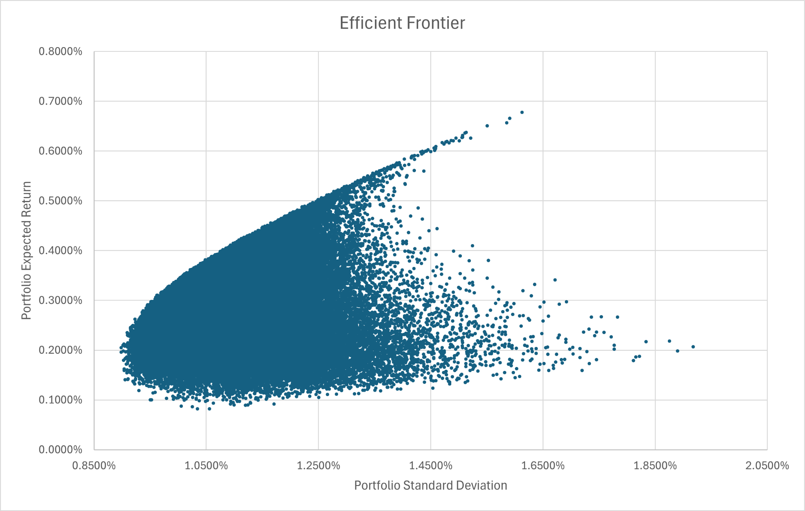

# Markowitz Portfolio Optimization in Excel

An Excel Solver project comparing portfolio allocations across five U.S. technology stocks using mean-variance portfolio theory.

Developed for **AMOD 5530: Portfolio & Risk Management** at **Trent University**, April 2026.

**[Excel workbook](model/portfolio_optimization.xlsx)** · **[Project report](reports/portfolio_report.pdf)** · **[Workbook guide](docs/workbook_guide.md)**

## Objective

Compare an equally weighted portfolio with a minimum-variance allocation and a maximum-Sharpe allocation. Examine the trade-off between estimated return, volatility, diversification, and concentration under a fully invested, long-only constraint.

## Data and scope

| Item | Specification |
| --- | --- |
| Assets | NVIDIA (NVDA), Apple (AAPL), Alphabet (GOOG), Microsoft (MSFT), and Meta (META) |
| Price window | July 15 to September 15, 2025 |
| Observations | 44 closing-price observations and 43 daily simple returns per stock |
| Price source in the workbook | Excel `STOCKHISTORY` |
| Risk-free assumption | Approximately 4.31% annually, converted using `(1 + annual_rate)^(1/252) - 1` |
| Allocation constraints | Weights sum to 1 and each weight is nonnegative |
| Implementation | Excel formulas, Solver, matrix calculations, and a What-If Data Table |

These are estimates from a short historical sample. The report describes selecting the date window after trying other periods. Results therefore describe this selected sample and do not establish future performance.

## Method

1. Calculate daily simple returns from closing prices.
2. Estimate each asset's mean return, variance, and standard deviation.
3. Construct a covariance matrix and examine correlations.
4. Calculate portfolio return, volatility, and excess return per unit of risk.
5. Use Solver to find minimum-variance and maximum-Sharpe allocations.
6. Compare the optimized allocations with an equal-weight benchmark and simulate 100,000 random portfolios.

For weights $w$, mean returns $\mu$, covariance matrix $\Sigma$, and a daily risk-free rate $r_f$:

$$
E[r_p] = w^T\mu, \qquad
\sigma_p = \sqrt{w^T\Sigma w}, \qquad
S_p = \frac{E[r_p]-r_f}{\sigma_p}.
$$

## Allocation comparison

The stored Solver allocations are:

| Portfolio | NVDA | AAPL | GOOG | MSFT | META |
| --- | ---: | ---: | ---: | ---: | ---: |
| Equal weight | 20.00% | 20.00% | 20.00% | 20.00% | 20.00% |
| Minimum variance | 12.41% | 24.99% | 8.32% | 54.27% | 0.00% |
| Maximum Sharpe | 0.00% | 0.00% | 90.69% | 0.00% | 9.31% |

The minimum-variance allocation emphasizes MSFT, while the maximum-Sharpe allocation concentrates on GOOG and META. This illustrates how an optimization objective can produce a concentrated portfolio even when several assets are available.

An independent numerical check of the supplied price snapshot reproduced these allocations to rounding precision. It did not run Excel Solver or refresh Excel's external data connections. The source workbook's covariance normalization and displayed correlation matrix need the corrections documented in the [calculation notes](docs/calculation_notes.md).

## Simulated portfolio opportunity set

The original chart displays 100,000 random portfolios. Its embedded title says “Efficient Frontier”; the plotted cloud is a simulated opportunity set. It does not trace a separately optimized efficient frontier or mark the three named portfolios.

## Repository contents

| Path | Contents |
| --- | --- |
| `model/portfolio_optimization.xlsx` | Original workbook with price data, formulas, saved allocations, Solver settings, and simulated portfolios |
| `reports/portfolio_report.pdf` | Project report, with the student identifier removed for public sharing |
| `figures/portfolio_opportunity_set.png` | Original Excel simulation chart |
| `docs/workbook_guide.md` | Cell references, Solver objectives, and instructions for navigating the model |
| `docs/calculation_notes.md` | Identified formula corrections and the effect on reported risk measures |

## Open and reproduce

Download the workbook and open it in desktop Excel. Enable the Solver add-in using [Microsoft's instructions](https://support.microsoft.com/en-us/excel/load-the-solver-add-in-in-excel), then follow the [workbook guide](docs/workbook_guide.md).

Refreshing `STOCKHISTORY` requires a supported Microsoft 365 subscription. The Treasury-yield input uses an Excel linked financial data type. This review used the stored yield values and did not verify live refresh in Excel. Record a fixed, documented risk-free assumption when reproducing the historical comparison.

The workbook in this initial package preserves the original calculations. Its sample-count and correlation formulas should be corrected, and affected report values and figures reconciled, before describing the entire model as validated.

## Interpretation and limitations

- The sample contains 43 daily returns and is sensitive to the selected dates.
- All five assets are large U.S. technology companies, so the asset universe has substantial sector concentration.
- The model uses historical sample means as expected returns.
- Taxes, transaction costs, turnover, and estimation uncertainty are not explicitly modelled.
- Annualized returns in the original report extrapolate daily estimates over 252 trading days. They are not realized annual returns.
- A normalized random-weight simulation illustrates feasible combinations. Its sampling does not uniformly cover all possible allocations.

## Author

[Amirhossein Sorour](https://github.com/amirhosseinsorour)

MSc in Applied Modelling & Quantitative Methods, Trent University.
